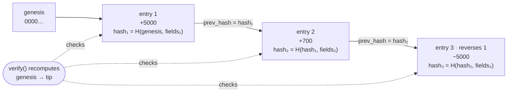

# Design notes

How the integrity holds, which layer enforces what, and the threat model —
including what this does **not** defend against. If you are storing real money
records, read the threat model before relying on any of it.

## The claim

> Money rows are never edited or deleted; a mistake is corrected only by a reversal
> that mirrors the original; a retried request is written once; and any edit to a
> stored row is detectable afterwards.

Three independent layers enforce that, so a bug (or a hand) in one does not quietly
defeat the whole thing.

## Layer 1 — the database refuses mutation (prevention)

`BEFORE UPDATE` and `BEFORE DELETE` triggers `RAISE(ABORT)` on the `entries` table.
This is enforced in SQLite itself, so the rule holds even for code that bypasses
this module and runs raw SQL — the tests prove it by issuing `UPDATE`/`DELETE`
directly and asserting they're refused. A reversal is also checked by a
`BEFORE INSERT` trigger: it must point at an existing, non-reversal entry and carry
the *same account and the opposite amount*. You cannot post a reversal that doesn't
balance, even in raw SQL.

## Layer 2 — uniqueness constraints (correctness)

- `idempotency_key` is `UNIQUE`: a retried request collides and returns the first
  result instead of writing twice. A key reused for a *different* request is
  refused (checked inside the write transaction).
- `reverses` is `UNIQUE` and references `entries(id)`: an entry can be reversed at
  most once, and a reversal cannot itself be reversed.
- `amount_cents` is `CHECK (typeof = 'integer' AND != 0)`: floats, booleans,
  strings and zero never reach the table. Money is integer minor units, one
  currency per ledger.

## Layer 3 — the hash chain (tamper evidence)

Every row stores `hash = sha256(prev_hash ‖ its own fields)`, chaining back to a
genesis of 64 zeros. The fields are **length-prefixed** before hashing
(`"5:acct_1" + "4:5000" + ...`), so two different rows can never serialise to the
same string — without that, `account="ab", memo="c"` and `account="a", memo="bc"`
would hash identically. `verify()` recomputes the whole chain and raises
`TamperError` on the first row whose stored hash disagrees. It catches an edited
row and a row removed from the middle (every later row's `prev_hash` breaks).

## The write path, and why concurrency is safe

`_append` runs `BEGIN IMMEDIATE` *before* it reads the current chain tip. `IMMEDIATE`
takes SQLite's write lock up front, so two writers cannot both read the same tip
hash and then both chain a new row off it (which would fork the chain). The read of
the tip, the hash computation, and the insert are one serialized transaction; on
any error it rolls back and nothing is written.

## Threat model — what each layer stops, and what it doesn't

| Threat | Defended by | Caveat |
|---|---|---|
| App code (or a bug) updating/deleting a row | Layer 1 triggers | — |
| Raw SQL updating/deleting, or posting an unbalanced reversal | Layer 1 triggers | Holds until someone `DROP`s the triggers |
| Double-processing a retried webhook | Layer 2 idempotency key | — |
| A row edited after the triggers are dropped | Layer 3 `verify()` | Detects, does not prevent |
| A middle row deleted after triggers dropped | Layer 3 (chain breaks) | Detected |

### What this does NOT defend against (read this)

- **Tail truncation.** Cutting the newest rows off the end leaves a chain that still
  verifies — `verify()` has no independent record of how long the chain *should* be.
  The fix is to store the latest hash (and a count) somewhere the database owner
  cannot rewrite: a separate append-only log, another system, or a periodically
  published anchor. This is the single most important external control.
- **A full rewrite by someone with write access *and* the hashing code.** The chain
  is tamper *evidence*, not tamper *proofing*: anyone who can write the file and run
  `_hash` can recompute a consistent chain from genesis. It raises the cost and
  catches casual edits and partial corruption; it does not replace access control,
  backups, and off-box anchoring.
- **Trusted time.** `created_at` is the application's own UTC clock and is part of
  the hash, so a wrong clock is locked in. This is not a timestamping authority.
- **Scale.** `balance()` and `verify()` are O(n) full scans; a large ledger wants
  periodic checkpoints (a signed tip at row N) rather than re-summing from genesis.
- **Accounting completeness.** This is a single-sided record of entries, not
  double-entry bookkeeping, and one currency per ledger. `reconcile()` matches on
  the idempotency key as the statement reference; a real bank/processor export
  rarely carries your key, so mapping their reference to yours is the integration's
  job.

## Testing

`tests/` runs under `python -W error::ResourceWarning`, so a leaked database
connection fails the build — which is why `Ledger` is closeable (`close()`, or
`with Ledger(path) as ledger:`). Several tests deliberately go around the module and
write raw SQL, to prove the rules live in the database, not only in the Python.
